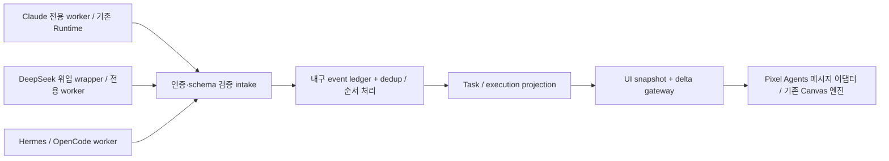

# P1-B — Multi Provider 설계 결정 (구현하지 않음)

상태: 제안. P1-A 앱은 로컬 Mock 전용이고 이 문서의 Bridge, 인증, 재연결, 실제 Provider 기능은 구현하지 않았다. 원본 Provider/Runtime 코드는 변경하지 않았다.

## 결정

**프로세스 분리형 Bridge를 먼저 도입하는 방식을 권장한다.** 현재 Claude runtime을 다중 Provider 안전성이 검증되기 전에 한 프로세스에서 여러 번 생성하지 않는다. Bridge는 신원·상관관계·검증·이벤트 이력을 소유하고, UI는 기존 Pixel Agents 메시지/엔진 경계로 연결한다. 기존 엔진을 복제하거나 새 게임 엔진을 작성하지 않는다.

| 선택 | Runtime 직접 확장 | 프로세스 분리형 Bridge |
|---|---|---|
| 변경 범위 | Provider registry, dispatch, scanners, parser, timers, session router, persistence를 instance scope로 정리 | 별도 intake/ledger/projection과 Provider별 worker. 기존 Claude worker는 최소 변경/별도 승인 |
| 전역 의존성 | 모든 module-level Provider/callback을 제거해야 함 | worker마다 process memory를 격리. 여러 Runtime을 한 worker에 넣지 않음 |
| 장애 범위 | parser/Provider 오류가 전체 런타임으로 전파될 수 있음 | worker별 timeout/restart/quarantine 가능 |
| 기존 의미 재사용 | 최대. 구현 완료 후 가장 단순한 데이터 흐름 | Claude runtime 의미를 유지하되 identity remapping, snapshot reconciliation과 운영 비용 추가 |
| 보안 | 수신 endpoint·설정 쓰기 capability가 같은 프로세스에 모임 | 외부 producer는 제한된 intake만 접근. Claude settings writer capability를 분리 가능 |
| 업스트림 병합 | 광범위한 내부 수정으로 충돌 가능성 높음 | 고정 SHA + 얇은 worker/메시지 어댑터로 경계 유지 |
| 최종 판단 | 장기적으로 적합. 전체 전역 상태 감사·회귀 테스트 후 검토 | 현재 가장 안전한 시작점. 운영 복잡성과 중복 projection 위험은 명시적으로 관리 |



ledger를 재구축 가능한 업무 상태의 기준으로 삼는다. worker의 세션 상태와 gateway의 UI 상태는 파생 projection이며 별도 업무 사실을 임의로 만들어서는 안 된다. Claude worker의 broadcast를 수집할 경우 모든 lifecycle 메시지와 최초 snapshot을 매핑하는 명시적 어댑터가 필요하다. CLI HTTP 200이나 raw broadcast만으로 실제 업무 의미가 보장되지는 않는다. 기존 Claude endpoint로 DeepSeek를 위장 송신하는 방식은 권장하지 않는다.

## 1. providerId별 dispatch

인증된 producer principal에 `providerId`, `instanceId`, 허용 event 종류를 바인딩한다. URL/JSON의 providerId와 불일치하면 403, 미등록 Provider는 404, schema 불일치는 422, 지원하지 않는 protocolVersion은 409로 실패시킨다. 원본처럼 무시 후 `ok`로 응답하는 동작을 성공 증거로 사용하지 않는다.

registry는 immutable `Map<ProviderId, ProviderWorker>`다. validated event만 해당 worker queue로 보내며, `_providerId`를 무시하거나 기본 Claude normalizer로 fallback하지 않는다. worker 응답도 해당 identity 범위인지 검사한다. 한 producer가 다른 Provider의 event를 대리 작성할 수 없다.

Runtime 직접 확장안을 선택한다면 `HookEventHandler`가 registry lookup으로 실제 Provider를 선택하고, `AgentRuntime`·file watcher·parser를 그 Provider context와 함께 생성하도록 바꿔야 한다. HTTP의 `session_id`/`hook_event_name` Claude 전용 gate도 중립 envelope로 교체해야 한다. 이 변경은 이번에 하지 않았다.

## 2. session namespace와 재연결 신원

- 세션 key: JSON 배열/구조체 `(providerId, installationInstanceId, nativeSessionId)`. 문자열 단순 이어붙이기는 escaping 충돌 때문에 금지한다.
- installationInstanceId는 설치 시 생성·보존하는 UUID다. 동일 Provider의 서로 다른 머신/계정에서 같은 native session id를 써도 충돌하지 않는다.
- connectionId는 전송 연결마다 바뀐다. **session/actor identity에 connectionId를 넣지 않는다.** 재연결이 새 캐릭터 생성으로 이어지면 안 된다.
- executionId는 한 실제 실행 시도. 재시도에는 새 executionId와 같은 logicalTaskId를 사용한다. resume의 세션과 task 실행을 혼동하지 않는다.
- Pixel Agents의 숫자 agentId가 필요하면 Bridge가 tuple/executionId→숫자 id의 안정된 mapping을 보존한다. worker의 로컬 숫자 id는 그대로 합치지 않는다.

## 3. 전역 의존성 처리

P0에서 확인한 `fileWatcher`, `transcriptParser`의 module-level Provider와 callbacks는 worker process 단위로 격리한다. 하나의 worker는 Provider context 하나만 갖는다. worker마다 별도 persistence namespace, watcher roots, timer registry, shutdown cleanup을 둔다. worker가 실제 Claude 사용자의 설정을 수정하는 권한은 기본적으로 주지 않는다.

장기 직접 확장 시에는 `ProviderContext { provider, sessionRouter, watcher, parser, timers, stateAdapter }`를 명시적으로 주입하고 mutable 전역을 제거한다. 검증에는 서로 다른 두 fake Provider를 번갈아 구동해 formatter, transcript root, timers, callback, 팀 metadata가 섞이지 않는 테스트가 필요하다.

## 4. Haiku 전달자와 DeepSeek 실제 실행 중복 방지

`logicalTaskId`(업무), `executionId`(실제 실행), `delegationId`(전달 관계), `actorRole`(relay/executor/observer)을 구분한다. Haiku가 DeepSeek에게 요청을 전달했을 뿐이면 relay로 기록하고 기본 사무실 캐릭터를 만들지 않는다. 실제 DeepSeek execution을 하나의 캐릭터로 투영한다. Haiku가 별도의 실질적 업무를 수행한 경우에만 독립 executor로 등록한다.

중복 억제는 이름이나 prompt 유사도 대신 동일 delegationId와 execution ownership으로 결정한다. `visibility=internal`인 relay 이벤트도 감사 timeline에는 남길 수 있다. DeepSeek callback이 늦게 도착하면 relay를 새 executor로 복제하지 않고 pending delegation의 실행과 결합한다. wrapper가 응답 받기 전에 실패하면 `deliveryUnknown`으로 기록하며 성공/실패를 추측하지 않는다.

## 5. 부모·자식·병렬 실행

제안 envelope 예시(문서 예시이며 현재 endpoint가 아님):

```json
{
  "schemaVersion": 1,
  "providerId": "deepseek",
  "instanceId": "installation-uuid",
  "sessionId": "native-session-id",
  "executionId": "attempt-uuid",
  "logicalTaskId": "task-uuid",
  "parentTaskId": "parent-task-uuid",
  "delegationId": "delegation-uuid",
  "eventId": "event-uuid",
  "sequence": 12,
  "occurredAt": "2026-10-15T00:00:00Z",
  "kind": "tool.started",
  "toolCallId": "tool-call-uuid",
  "activity": "analysis",
  "actorRole": "executor",
  "source": "live"
}
```

parentTaskId는 업무의 부모이고 executionId는 실행 시도다. 병렬 자식마다 고유 task/execution/toolCall id를 부여한다. Runtime의 “처음 발견한 Task” 검색으로 부모를 결정하지 않는다. 부모보다 자식 이벤트가 먼저 오면 크기와 시간이 제한된 pending queue에 보관하고, 부모 도착 시 결합한다. 기한을 넘기면 orphaned/unknown으로 감사 기록한다. 순환·자기 참조·다른 principal 소유의 부모에 대한 무단 결합을 거부한다. Analyst/Dev를 이름 있는 Teammate, 무명 일시 위임을 Sub-agent, 독립 세션을 Agent로 표현하는 원본 CONTEXT 의미와도 맞춰야 한다.

## 6. 누락·중복·순서 역전·재연결

| 상황 | 명시적 처리 |
|---|---|
| 중복 배달 | eventId에 ledger unique constraint. 이미 수락했다면 같은 ack를 반환하고 완료 건수를 늘리지 않는다. |
| 순서 역전 | execution별 sequence와 제한된 reorder buffer(예: 256개/5초)를 사용. 연속 구간만 commit하며 시각만으로 정렬하지 않는다. |
| sequence 누락 | high-water mark와 빠진 범위를 알려 replay 요청. 해결되지 않으면 unknown/stale로 표시하고 작업 중·완료로 추측하지 않는다. |
| 종료 뒤 늦은 이벤트 | terminal sequence보다 오래된 toolStart는 무시하고 감사 기록. 새 시도는 새 executionId를 사용하며 종료한 시도를 부활시키지 않는다. |
| producer 연결 끊김 | 연결 freshness와 업무 status를 분리. 끊김이 업무 실패를 뜻하지 않는다. 마지막 확인 상태와 수신 시각을 표시하고 캐릭터를 비활성화한다. |
| 재연결 | 마지막 acknowledged sequence/cursor부터 replay. 보관 기한을 넘기면 versioned snapshot 이후 delta 적용. snapshot 중 delta는 buffer하고 revision으로 일치시킨다. |
| worker 재시작 | durable ack 이후에만 producer에 성공 응답. ledger로 projection을 복원하며 in-memory dedup에만 의존하지 않는다. |
| 제거와 재등장 | 사용자 dismiss와 실행 종료를 분리. dismiss tombstone으로 지연 snapshot에 의한 임의 복원을 막는다. |

업무 상태는 producer의 검증된 명시 이벤트가 있을 때만 확정한다. coding/analysis/testing을 도구 이름이나 침묵만으로 단정하지 않는다. 일일 완료 건수는 terminal task transition을 멱등 집계하며 재시도·재송신으로 늘리지 않는다. 날짜 경계는 사용자 timezone을 사용하고 producer 시계 차이는 receivedAt과 비교해 기록한다.

## 7. 인증·검증·민감정보

- 로컬은 권한 제한 Unix socket 또는 loopback+짧은 수명의 scoped token. 호스트 간에는 TLS와 mTLS 또는 서명 인증을 사용한다. Origin/Host/네트워크 위치만으로 신원을 신뢰하지 않는다.
- token을 provider/instance와 read/write scope에 제한한다. UI 관찰 권한과 Hook 설치 권한을 분리하며 Bridge에 Claude settings 쓰기 권한을 주지 않는다. 새로운 비밀을 URL query에 넣지 않고 Authorization 등 전용 경로를 사용한다.
- body 제한(예: 32 KiB), rate limit, timestamp/nonce/sequence replay 제한, protocolVersion, strict schema, additionalProperties=false, 문자열 길이·enum 제한을 입구에서 적용한다.
- allowlist된 구조 필드만 투영한다. API key, Authorization, 환경 값, prompt, 모델 응답, tool input/output 전문, 파일 전문은 받지 않는다. 경로는 basename 또는 사전 등록 ID로 제한한다. 라벨도 길이 제한·HTML 비활성화·제어문자 제거가 필요하다.
- 정규식 비밀 탐지는 보조 수단일 뿐 보안 보장이 아니다. 알 수 없는 필드는 저장 전에 거부하고 오류 응답·로그에도 값을 넣지 않는다. 감사 로그는 eventId와 거부 이유만 기록한다.
- 만료·키 교체·폐기·연결 종료를 포함한다. 권한 없는 producer의 다른 세션/부모 업무 갱신을 금지한다.

## 구현 착수 전 수락 시험

서로 다른 두 fake Provider가 같은 nativeSessionId를 써도 actor가 분리되는지, 재연결 시 actor가 늘지 않는지, Haiku relay+DeepSeek executor가 executor 하나로 보이는지, 부모 1개와 병렬 자식 10개의 상관관계가 유지되는지 검사한다. duplicate/reorder/drop/restart/stale snapshot/종료 뒤 지연/queue overflow를 fault injection으로 검증한다. 무인증·Provider 사칭·과대 payload·비밀 필드·HTML 라벨·부정 parent 참조 거부도 시험한다. 기존 엔진 테스트와 승인된 실제 Claude 검증을 회귀 게이트로 둔다.

## 실제 Claude 연결에 필요한 별도 작업

1. Claude CLI·인증·실제 workspace/session이 있는 대상 머신을 확인한다. 비밀 값은 채팅에서 받지 않는다. 먼저 읽기 전용 discovery와 가능한 Hook 없는 heuristic을 검증한다.
2. Hook이 필요하면 **설치 전** 대상 `~/.claude/settings.json`의 비밀 값을 가린 예상 Diff, `~/.pixel-agents/hooks/claude-hook.js` 등 생성 파일, 12종 Hook 이벤트, 송신 대상·payload 범위·백업·복구 방법을 제시하고 명시적 승인을 받는다.
   대상 이벤트: SessionStart, SessionEnd, Stop, PermissionRequest, Notification, PreToolUse, PostToolUse, PostToolUseFailure, SubagentStart, SubagentStop, TeammateIdle, TaskCompleted. 예상 변경은 각 hooks.<Event> 배열에 Pixel Agents command 항목을 추가하는 것이며 기존 항목을 대체하면 안 된다. Pixel Agents consent/config와 로컬 server registry도 생성될 수 있으므로 적용 전 파일 목록에 포함한다.

3. 원본 bytes/mode를 비공개 백업으로 보존하고 복원 가능성을 확인한다. 원본 installer는 `.pixel-agents.backup` 1회 백업과 atomic rename을 쓰지만 동시 갱신 경쟁이 완전히 없어지는 것은 아니다. 기존 Hook과 다른 도구의 항목을 유지하고 OMP 설정·스크립트에는 손대지 않는다.
4. 승인된 파일에만 적용하고 실제 Diff를 확인한다. 짧은 실Claude 세션의 Read/Write, 입력/승인 대기, foreground/background 서브에이전트, 병렬 자식, Stop/SessionEnd, 재시작을 HTTP→store→WS→화면에서 추적한다. Mock 결과와 별도로 기록한다.
5. 실패 시 이번에 추가한 Hook 항목만 제거한다. 원본 파일이 있었다면 동시 갱신이 없는지 확인한 뒤 bytes/mode를 복구하고, 원래 없었다면 이번 생성물만 삭제한다. 변경 후 다른 사용자 편집을 오래된 백업으로 덮어쓰지 않는다. Diff·hash·실동작을 확인한다.

위 절차는 설계이며 이번에는 실행하지 않았다.
