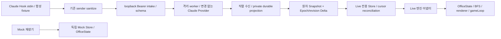
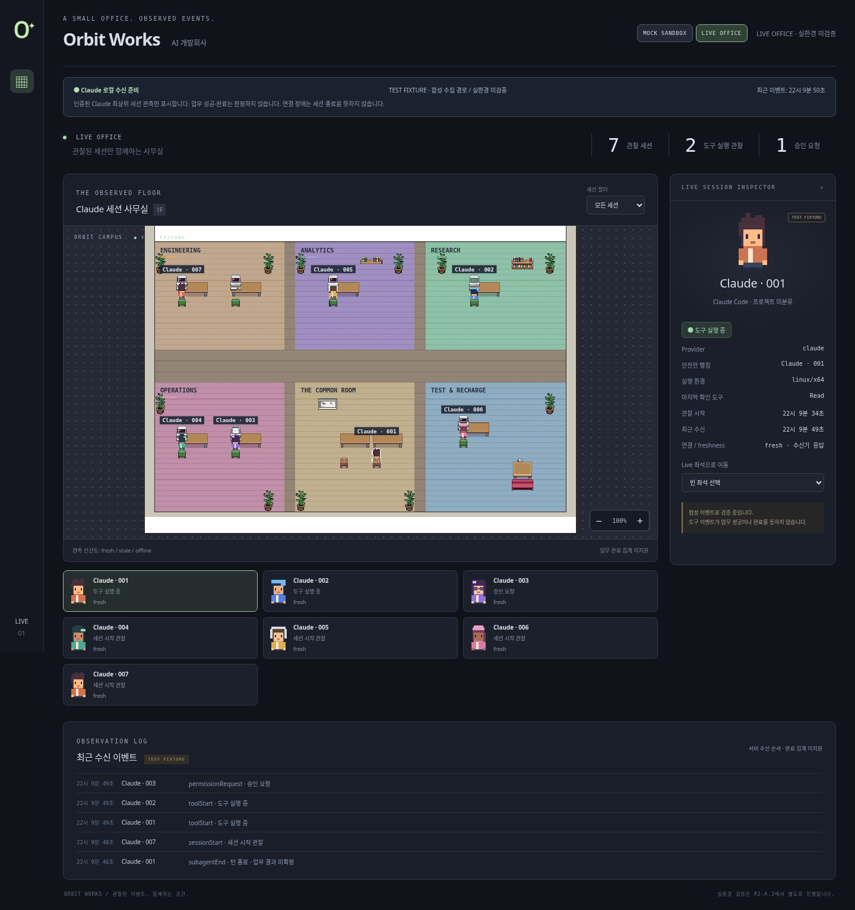

# P2-A.2 Live Canvas 구현 및 검증

기준 work/d2b614d. 실제 Claude 실환경 연결은 **미검증**이며 P2-A.3에서 별도 판정한다. 이 단계는 합성 Hook → 인증 intake → 원본 Claude Provider worker → 영속 projection → Snapshot/Delta → Live Store → 기존 Canvas를 구현한다. P2-B는 포함하지 않는다. 최종 SHA와 최신 세 OS CI 링크는 완료 보고를 기준으로 한다.

## 실행과 데이터 경계

기본 `npm start`는 Mock 서버다. UI 상단에서 MOCK SANDBOX / LIVE OFFICE를 명시적으로 선택한다. Mock 서버의 Live 탭은 **연결 준비 필요 / 캐릭터0명**이다. mode 선택만 localStorage `orbit.mode.v1`에 저장한다. Mock/Live 컴포넌트는 별도의 Store와 OfficeState, 선택·필터·zoom·좌석을 유지한다. Live에서는 Mock 초기 이벤트/roster/시나리오를 실행하지 않는다. Mock 시나리오는 탭을 떠나면 중단한다. 장애 시 Mock으로 전환하지 않는다. Mock 화면의 기존 수집 패널은 호환용 읽기 전용이며 Mock 집계와 합치지 않는다.

실기 연결 준비 후 대상 머신에서만 `ORBIT_MODE=claude-local npm start`를 사용한다(PowerShell은 `$env:ORBIT_MODE='claude-local'; npm.cmd start`). 이는 Orbit 전용 상태를 만들지만 사용자 Hook/settings를 설치하지 않는다. 클라우드 검사는 모두 별도 임시 stateDir/source=fixture이며 실제 사용자 상태로 opt-in 실행하지 않았다. 실제 이벤트가 와도 **실환경 미검증** 표시를 유지한다.

## 신원·생성과 상태

- 인증·검증된 root SessionStart만 새 actor를 만든다. 서버 영속 Snapshot은 그러한 관측의 복원이다. toolStart/CLI 존재/좌석/이름/자식 관측은 생성 근거가 아니다. SessionEnd가 먼저 오면 생성하지 않고 terminal 기록만 남긴다. 명시적인 agent_id/parent_session_id가 붙은 일반 lifecycle/tool 이벤트는 현재 root 범위에서 거부한다. SubagentStart/Stop/TeammateIdle/TaskCompleted는 부모 timeline 보조 관측이며 새 캐릭터·업무 완료를 만들지 않는다.
- namespace는 `(claude, installationInstanceId, nativeSessionId, generation=1)`이다. native ID 대신 private salt의 HMAC key를 보존한다. UUID actorId와 단조 증가 numeric renderId, palette를 영속 보존한다. session/CLI 경로/프롬프트를 별칭으로 쓰지 않는다. 서로 다른 설치/fixture/live state는 분리된다. UI가 다른 설치로 전환되면 OfficeState와 선택/매핑을 새 scope로 초기화한다.
- 원본 sender에는 generation/eventId/sequence가 없다. **동일 native ID 종료 후의 SessionStart도 재전송과 실제 resume를 구분할 수 없어 거부**한다. 새 native 세션은 새 actor다. clear/resume/compact의 실기 의미와 동일 ID 재개는 P2-A.3 계약 확인이 필요하다. 이 안전 제약을 자동 완화하지 않는다.
- 중복 SessionStart는 actor를 늘리거나 시작 시간을 초기화하지 않는다. 재시작 후 해당 세션 재관측은 stale을 해제하되 observed로 표시한다. toolStart/End는 실제 반복 호출일 수도 있어 유사 payload로 dedup하지 않는다. 서버 revision은 **수신 순서**이며 원래 실행 순서의 증거가 아니다.

| 관측 | 상태 / 엔진 |
|---|---|
| SessionStart | addAgent, 중립 자세, 프로젝트 미분류 |
| Read/Grep/Glob toolStart | 기존 Read animation + sendToSeat/BFS |
| Edit/Write toolStart | 기존 Write animation + sendToSeat/BFS |
| Bash/기타 toolStart | 실행 중 표시, 중립 자세; 코딩이라고 추측하지 않음 |
| PermissionRequest | 승인 말풍선 |
| idle_prompt | 입력 대기 말풍선 |
| PostToolUseFailure | 도구 실패 경고; 업무 전체 실패로 집계하지 않음 |
| PostToolUse | 도구 종료·다음 상태 미확인 |
| Stop | 턴 종료, actor 유지, 완료 집계 없음 |
| SessionEnd | active 집계에서 즉시 제외, 좌석 반환, 기존 despawn 동안 render만 유지 |
| 수신 후30초/120초, 또는 서버 장애 | stale/offline. 업무 상태·종료와 분리, 중립/비활성화 |

lastTool은 마지막으로 확인된 허용 tool 이름이다. 프로젝트/작업명을 추정하지 않고 Live 완료 count는 미지원이다. 도구 실행·승인 지표는 fresh인 세션만 집계한다. 관찰 세션 수는 종료가 관찰되지 않은 멤버십이며 실제 OS 프로세스 생존 수를 보장하지 않는다.

## 저장·동기화·보안

OS별 기존 private state root의 `live/claude-live.json` 또는 테스트 `claude-fixture.json`을 사용한다. Windows LOCALAPPDATA/Orbit Works, macOS Library/Application Support/Orbit Works, Linux XDG_STATE_HOME/orbit-works 또는 ~/.local/state/orbit-works다. 기존 Windows ACL/.NET·Hook launcher·registry 보호 코드는 약화하지 않았다.

새 private 디렉터리 검증 → 새0600/private-ACL temp 파일 exclusive 생성 → fsync → 같은 디렉터리 rename → POSIX directory fsync 순으로 원자 projection을 저장한다. 성공 후에만 HTTP ack와 in-memory revision을 공개한다. owner/ACL/symlink/크기/schema가 불안전하거나 저장에 실패하면 fail closed한다. 손상 데이터를 자동 삭제·초기화하지 않는다. 원본 registry wx가 단일 수신기 소유를 제한하며 init 실패 시 자신이 생성한 registry만 정리한다. 새 native DB/전역 패키지/셸 의존성은 없다.

최소 저장 필드: 설치 UUID/private HMAC salt, key→actor/render/palette mapping, generation1, 관찰 상태·허용 tool·시각, terminal/tombstone, revision, 최근100개 구조 이벤트. token은 기존 runtime registry만 사용한다. raw native ID·prompt·cwd·transcript·tool input/output·임의 이름은 저장/화면/오류 로그에 넣지 않는다. salt/ledger/registry 자체는 공유하지 않는다. source는 서버만 정한다. body64KiB, 대기64개, worker2초 제한과 현재 loopback Host/Origin/HttpOnly SameSite cookie·Bearer 인증을 유지한다.

상한은 활성100, 전체 identity/tombstone1000, persisted2MiB, delta128, timeline100이다. 정원 초과는429이며 tombstone을 지워 부활시키지 않는다. 안전한 compaction/export/migration UI는 미구현이다. 불명 terminal·장기 관측 만료의 운영 정리와 Windows 파일 fsync/성능·전원 장애 내구성 실기는 남았다. rename+fsync는 임의 하드웨어 장애까지 증명하지 않는다.

`GET /api/live/snapshot`은 epoch/revision/cursor/source/installation/actors/tombstones/timeline을 동기적으로 원자 반환한다. `GET /api/live/events?after=<epoch:revision>`은 연속 Delta 또는 resetRequired를 반환한다. 두 API도 기존 브라우저 cookie가 필요하다. Mock 서버는409, 미인증은401이다. delta ring은 메모리에만 있으며 서버 재시작 시 새 epoch와 authoritative Snapshot으로 복원한다. 저장된 actor는 **stale**로 시작해 개별 재관측 후 해제한다.

UI는 snapshot 후 cursor부터 한 요청씩 polling하며, 중복 revision은 멱등 처리하고 이전 snapshot/revision을 버린다. gap/역순/epoch mismatch/overflow면 전체 Snapshot을 다시 읽는다. 모드 변경·unmount는 AbortController/disposed generation으로 늦은 응답을 폐기한다. tombstone은 지연 upsert/snapshot의 부활을 막는다. 전송 장애는 기존 관측을 offline으로 유지한다. Mock fallback은 없다.

이는 서버→UI 전달 정합성이다. Hook→서버 최초 이벤트 유실/순서 역전/중복은 producer eventId/sequence/spool/ack/replay 없이 완전히 복원할 수 없다. SessionStart 유실 시 이후 도구만으로 actor를 만들지 않는다. SessionEnd 유실 시 실제 종료를 추정하지 않고 stale/offline으로 남긴다. 같은 OS 사용자 권한의 악성 송신자가 가진 token까지 방어하거나 인증 이벤트가 실제 Claude 실행을 증명한다고 주장하지 않는다.

## 자동화와 화면 증거

- `npm test`: 기존16 + Live Store2. 중복·역순·gap·epoch/source 변경·오래된 Snapshot·종료 tombstone·freshness·잘못된 표시 데이터 검사.
- `npm run test:integration`: 기존5 + Live2 + Windows 전용4. 실제 HTTP 인증/원본 Provider/병렬6세션/정확한 도구 상태/Stop/SessionEnd/지연 부활 거부/재시작 identity·palette 복원/민감정보·private 파일/capacity/손상 거부를 검사한다. Windows4개는 Linux/mac에서 skip이다.
- `npm run test:live-browser`: 합성 stdin → 실제 패키징 sender → 실제 인증 HTTP → 원본 Provider worker → 디스크 projection → 실제 API → Store → Canvas를 검사한다. DOM에 가짜 캐릭터를 직접 주입하지 않는다. 7개 병렬 actor, reading/typing/중립Bash/말풍선, 모드·좌석 분리, 새로고침·서버 재시작·stale, 실제 Delta 응답 누락 후 Snapshot, despawn, 장애 시 Mock fallback 없음, 미준비 collector, 모바일·JS 오류·DOM/저장 민감정보 배제를 검사한다.
- 기존 Mock·connection 브라우저, smoke, 단위·통합·원본643 테스트를 유지한다. CI matrix에 Live browser를 추가했다. 정확한 최신 SHA의 **세 OS 전체 성공 후에만** CROSS_PLATFORM_CI_PASS다. Windows 원본 POSIX 전용8 skip은 유지하며 새 skip을 추가하지 않았다.
- 화면: `artifacts/live-office-synthetic.png`, `artifacts/live-office-mobile.png`. 이는 **합성 Live 수집 경로** 증거이며 실제 Claude 실환경 성공 증거가 아니다. ignored artifacts는 snapshot 복원을 보장하지 않는다. 공유 가능한 정적 사본은 docs/images에 제공한다.

[Mac 실환경 사전 점검·Hook 예상 Diff·복구 절차](P2-A.3-VALIDATION-PLAN.md)는 계획만 제공한다. 실제 Hook 설치, Claude/Command Code/OMP 설정 변경, DeepSeek 위임 스크립트 변경, Hermes 연동, 외부 포트/원격 배포는 하지 않는다.

## 로컬 Linux 검증 결과

Node22.23.3/Linux x64에서 build·typecheck·Lint·단위18·통합7통과/Windows4skip·Mock smoke·Mock/connection/Live 브라우저·원본 webview86/server550/contract7=643 통과를 확인했다. upstream의 기존 useEffect warning1은 남는다. 실제 Windows/macOS 결과는 최신 커밋의 Actions 전체 결과를 별도로 확인하며 로컬 결과로 대체하지 않는다.

[모바일 합성 화면](images/p2-a2-live-mobile.png)

## 변경 파일

- `.github/workflows/cross-platform.yml`
- `README.md`
- `docs/ADAPTERS-AND-REMOTE.md`
- `docs/P2-A.2-IMPLEMENTATION.md`
- `docs/P2-A.2-LIVE-CANVAS-DESIGN.md`
- `docs/P2-A.3-VALIDATION-PLAN.md`
- `docs/images/p2-a2-live-desktop.png`
- `docs/images/p2-a2-live-mobile.png`
- `package.json`
- `scripts/browser-diagnostics.mjs`
- `scripts/connection-browser.mjs`
- `scripts/live-browser.mjs`
- `server/app.mjs`
- `server/claude-input.mjs`
- `server/claude-worker.ts`
- `server/live-projection.mjs`
- `server/receiver.mjs`
- `src/App.tsx`
- `src/Canvas.tsx`
- `src/ModeSwitch.tsx`
- `src/live/LiveOffice.tsx`
- `src/live/engine-adapter.ts`
- `src/live/store.ts`
- `src/live/useLiveOffice.ts`
- `src/style.css`
- `tests/connection.integration.mjs`
- `tests/live-store.test.ts`
- `tests/live.integration.mjs`
