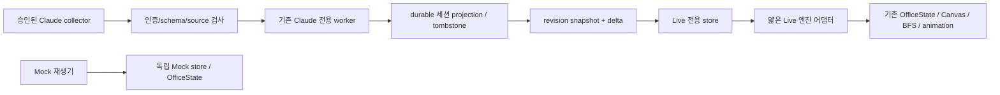

# P2-A.2 Live Canvas 설계 — P2-A.1 당시 제안

현재 구현·수락 검사와 설계 대비 제약은 [P2-A.2 구현 보고](P2-A.2-IMPLEMENTATION.md)를 따른다. 아래는 P2-A.1 당시 설계를 보존한 이력이다.

P2-A.1 범위에서는 설계만 작성한다. App/Canvas/engine/receiver/Claude Provider의 Live 통합 코드는 변경하지 않는다. Hook 설치, sender protocol 변경, 외부 Provider/P2-B는 별도 승인 대상이다.

## 현재 경계

App.tsx는 initialEvents로 Mock roster 6명을 만들며 model.ts의 Agent/OfficeEvent는 source=mock이다. syncAgent는 Mock 상태에서 Read/Test/Write를 선택하므로 Live를 그대로 통과시키면 미확인 활동을 Write로 표현할 수 있다. ConnectionPanel은 2.5초 polling으로 별도 수신 상태를 보여 준다.

현재 sanitizer/worker는 도구·자식 고유 ID를 보존하지 않으며 worker는 원본 normalizeHookEvent 결과를 sessionId/kind/awaitingInput/failure로 축약한다. receiver의 session map과 sequence는 메모리뿐이다. 원본의 current placeholder를 실제 자식 ID로 쓰면 안 된다.

## 모드와 생성

- mock/live discriminated union과 별도 store·OfficeState를 사용한다. 모드 변경은 서버 capability로 확인하고 기존 actor/timer/선택을 정리한다. Live에서 initialEvents/roster/playScenario를 호출하지 않는다. 인증 실패·연결 장애 시 Mock으로 자동 fallback하지 않는다.
- 빈 Live collector는 캐릭터 0명이다. 인증/schema/source 검사를 통과한 SessionStart 또는 authoritative active snapshot membership만 생성 근거다. start 근거 없는 toolStart는 bounded orphan queue/진단으로 남기고 캐릭터를 만들지 않는다. 저장 좌석/CLI 경로/token 존재/provider 이름은 생성 근거가 아니다.
- 운영 Live, Mock, 합성 fixture를 서버가 구분한다. fixture는 TEST FIXTURE로만 표시하며 운영 Live로 승격하지 않는다. DeepSeek/Command Code/Hermes는 실제 Adapter 검증 전 등장하지 않는다.
- 로컬 bearer token은 수신 권한의 근거일 뿐 실제 Claude 실행을 암호학적으로 증명하지 않는다. 같은 OS 사용자 권한의 악성 producer까지 방어한다고 주장하지 않는다. 보장 범위는 검증된 lifecycle 관측만 actor로 투영하고 샘플·추정 신원을 배제하는 것이다. 실기 검증 전에는 Live transport / 실환경 미검증 표시를 유지한다.

## 신원

canonical key는 `(providerId, installationInstanceId, nativeSessionId, sessionGeneration)` 구조체다. Windows/WSL은 다른 설치 instance다. connectionId를 세션 신원으로 사용하지 않는다. 명시 새 실행/재개 근거 없는 재연결은 generation을 바꾸지 않는다.

서버가 opaque actorId를 영속 발급하고 숫자 renderId는 충돌 검사를 갖춘 별도 일대일 mapping으로 보존한다. raw ID parseInt/hash%숫자범위를 쓰지 않는다. 재연결/새로고침/snapshot이 캐릭터를 증식시키지 않게 한다. 6종 sprite palette는 stable actorId로 선택하되 palette는 신원이 아니다. 팀/프로젝트는 사용자 등록 비민감 metadata 또는 미분류이며 prompt/cwd로 추정하지 않는다.

초기 Live는 정확한 root Claude 세션부터 다룬다. 현재 자식 identity 손실 때문에 SubagentStart/Stop은 부모의 부가 관측만 표시하며, 검증된 자식 ID/부모 correlation이 생기기 전 독립 자식 캐릭터를 만들지 않는다.

## 상태와 엔진

Live 상태는 observed/tool-running/between-tools/approval/waiting-input/turn-ended/tool-failed/session-ended/unknown이며 freshness=fresh/stale/offline을 별도로 둔다. Mock의 coding/analysis/testing/completed를 업무 사실처럼 재사용하지 않는다.

| 명시 관측 | 표시와 기존 엔진 처리 |
|---|---|
| SessionStart | addAgent로 한 명 생성, 빈 좌석 또는 대기 위치. 코딩이라고 확정하지 않음 |
| toolStart | 도구 실행 중. worker가 반환하는 허용 toolClass로만 읽기/타이핑. 미확인 class는 중립 자세 |
| toolEnd | 도구 종료·다음 상태 미확인. 최종 업무 완료로 집계하지 않음 |
| PermissionRequest | 승인 요청 말풍선. 승인 완료를 추측하지 않음 |
| Notification idle_prompt | 입력 대기. 실제 커피/휴식으로 단정하지 않음 |
| Stop | 턴 종료. 세션 캐릭터 유지, 업무 성공·축하·완료 count 증가 없음 |
| PostToolUseFailure | 도구 실패. 세션 전체 실패/종료로 확정하지 않음 |
| SessionEnd | durable terminal/tombstone, bubble/timer/작업 정리, removeAgent로 좌석 반환·despawn |
| 수신/연결 단절 | stale/offline 표시와 비활성화. 종료/실패/성공을 만들지 않음 |

Live thin adapter가 기존 addAgent/setAgentActive/setAgentTool/showPermissionBubble/dismissBubble/sendToSeat/removeAgent를 호출한다. OfficeState.update, startGameLoop, renderer, reassignSeat/BFS, sprite sheets를 재사용한다. 기존 syncAgent의 기본 Write 선택은 Live에 적용하지 않는다. 정원 초과 시 기존 actor를 덮어쓰지 않는다.

원본 removeAgent는 좌석을 즉시 반환하고 despawn을 시작한다. 퇴장 actor를 집계·상호작용에서는 즉시 제외하되 임시 render 목록에 유지하고 engine.characters에서 삭제된 뒤 목록을 비워 애니메이션이 보이게 한다. 필터 숨김과 실제 remove를 구분한다. 선택된 actor 종료 시 inspector를 비운다. StrictMode/늦은 응답은 generation/AbortController로 차단한다.

layout geometry는 재사용할 수 있으나 seat mapping은 mock/live·installation·actor namespace로 분리한다. localStorage에 active actor 목록을 권위 상태로 저장하지 않는다. 실행 시간은 관측 경과로 표시하며 실제 업무 시작/CPU 시간으로 단정하지 않는다. 명시 task completion protocol 전까지 업무 완료 count는 미지원이다.

## snapshot/delta와 신뢰성

제안 API(미구현): `/api/live/snapshot`이 serverEpoch/revision/source/scope/receivedAt/actors/tombstones/lastEventAt을 원자적으로 반환하고 `/api/live/events?after=<cursor>`가 연속 delta와 gap/resetRequired를 반환한다. 기존 same-origin HttpOnly cookie 및 loopback Host/Origin 정책을 재사용한다. polling/long polling으로 시작하며 WebSocket은 필수가 아니다.

| 상황 | 처리 |
|---|---|
| UI 중복/역전 refresh | epoch/revision/eventId로 멱등 처리. refresh는 하나씩, 오래된 응답은 폐기 |
| delta gap/overflow/만료 | 연속 revision만 적용, bounded buffer 후 authoritative snapshot 재동기화 |
| snapshot 동시 이벤트 | revision R의 원자적 snapshot 후 R 이후 delta만 적용 |
| 종료 후 지연 이벤트 | generation/cursor terminal tombstone으로 부활 금지. 검증된 새 generation/start만 재생성 |
| start/end 유실 | start 없으면 생성 금지. end 없으면 TTL로 stale/expired-observation 표시·숨김 가능하나 실제 종료라고 기록하지 않음 |
| 재시작 | private durable ledger/mapping/tombstone 복원. 미재검증 actor는 stale. in-memory 초기화를 실제 종료로 간주하지 않음 |
| 재연결 | cursor/snapshot으로 재개하며 다른 epoch/instance 데이터를 혼합하지 않음 |

현재 Hook에는 producer eventId/sequence/replay가 없다. receiver arrival sequence만으로 Hook→서버 유실·재송신 중복·원래 발생 순서를 복원할 수 없다. kind/tool/시각 유사도로 dedup하면 정상 반복 실행을 삭제하므로 금지한다. UI 전달 정합성과 end-to-end 보장을 분리한다.

강한 보장에는 별도 승인된 collector/sender 계약이 선행되어야 한다: eventId를 최초 생성 후 재시도에서 유지, sessionGeneration/허용 opaque toolCallId/인과관계·sequence, private spool/ack/replay, bounded retry, 병렬 Hook enqueue 직렬화. 서버는 durable idempotency commit 후 ack하며 같은 ID의 다른 payload는 거부한다. producer가 발생 순서를 보장하지 못하면 confidence=unknown이다. 그 전 exactly-once나 완전한 순서 보장을 주장하지 않는다.

ledger는 허용 구조 필드만 저장한다. prompt/cwd/transcript/tool input/output/인증정보를 추가하지 않는다. OS별 private state에 append/recovery·원자 snapshot·fsync·정원/보존기간·손상 감지 정책을 둔다. 저장 기술은 별도 ADR로 정하고 새 native DB 의존성이 Windows/ARM 호환성을 깨뜨리지 않도록 검증한다.

## 구현 순서와 수락 시험

1. 별도 승인 후 Claude 단일 provider lifecycle projection, durable identity/tombstone, schema/신뢰 경계를 먼저 만든다.
2. fake tests로 빈 화면/phantom 금지, 같은 native ID의 다른 instance 분리, 반복 tool 이벤트 보존, 동시5세션 이상, 종료 후 지연·재시작을 검증한다.
3. snapshot/delta·독립 Live store/reducer에 duplicate/reorder/gap/epoch reset/동시 refresh fault tests를 추가한다. fixture가 운영 Live에 섞이면 실패시킨다.
4. 기존 엔진 adapter/UI를 연결하고 Mock·upstream tests를 유지한다. 실제 세션 없으면 actor0, 401/403 시 fallback 없음, 세션 종료·좌석 반환·despawn을 브라우저로 검사한다.
5. 대상 OS에서 승인된 실제 Claude SessionStart/도구/승인/Stop/SessionEnd를 원본 증거와 대조한다. Hook/sender 변경은 Diff·백업·복구·승인부터 수행한다.
6. Command Code/DeepSeek/Hermes는 P2-B 별도 범위이며 공식 이벤트와 신원을 확인하기 전 캐릭터를 만들지 않는다.
