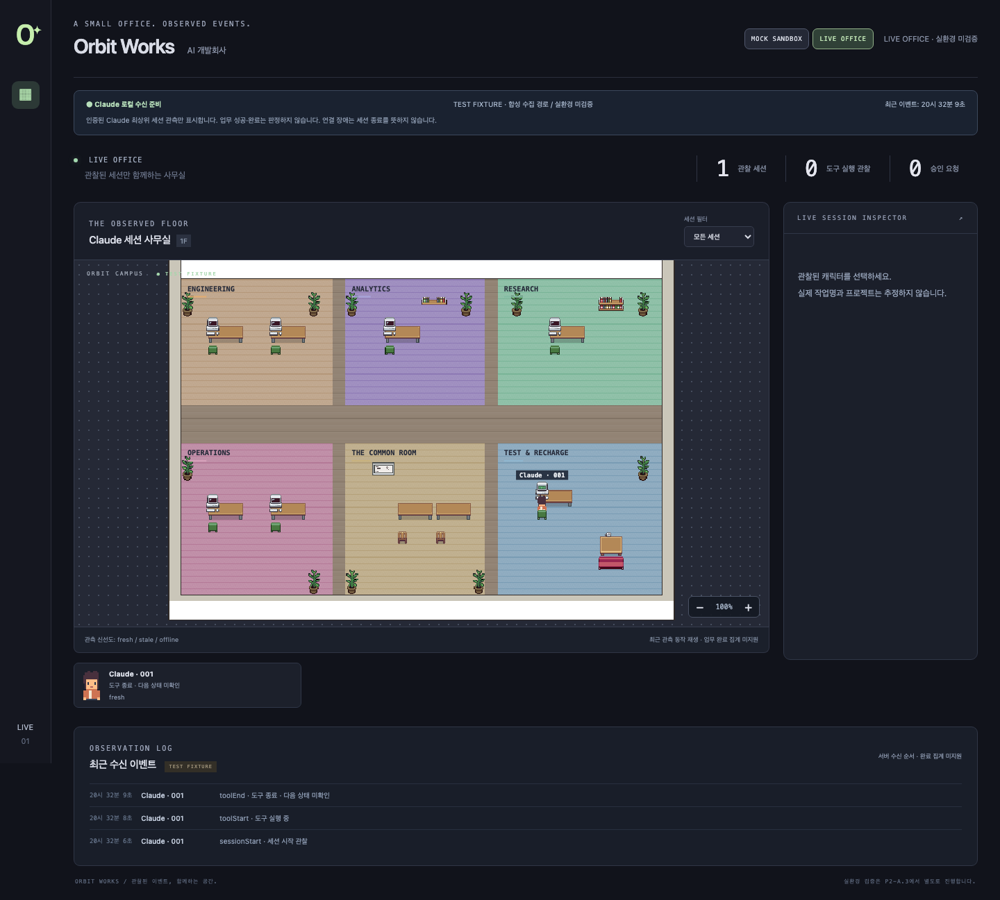
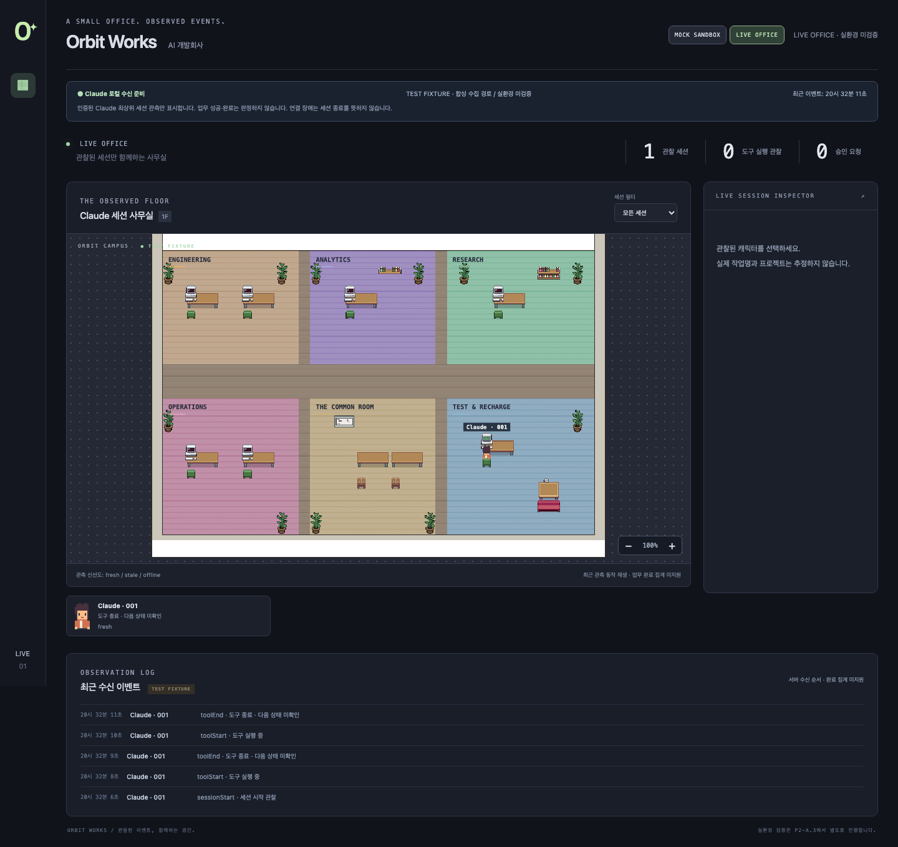

# P2-A.4 — Live 애니메이션과 종료 세션 Resume

## 원인과 시각적 동작

P2-A.3에서는 여러 Delta를 최종 actor 상태 하나로 합쳐 toolStart/toolEnd 중간 관찰을 화면에 전달하지 못했다. 짧은 이벤트가 전달돼도 좌석 BFS가 끝나기 전에 도구가 종료될 수 있었다.

이제 timeline에 서버가 허용한 tool 분류와 generation을 포함한다. 실제 업무 상태는 종전처럼 PostToolUse 시 즉시 between-tools로 바뀌고, UI의 실행 중 집계도 이 실제 상태만 사용한다. 별도 `LiveAnimationScheduler`는 새로운 toolStart 관찰을 기억해 **750ms** 동안 기존 Pixel Agents의 Read/Write pose를 재생한다. 이 연출은 actor 데이터·종료 시각·업무 완료 집계를 바꾸지 않는다. 최종 상태가 도구 종료인 동일 polling batch에서도 실제 관찰된 동작을 보여 준다.

600/750/900ms 후보는 단위 검사에서 100/200/300ms 작업과 비교했다. 실제 Chromium에서 선택한 750ms의 Read/Write 표시를 약 700~792ms로 측정했다(화면·React tick 단위 오차 포함). 장기 이동을 기다리지 않고 기존 type pose를 현재 위치에서 시작하며 원본 Renderer/gameLoop와 프레임을 사용한다. ongoing 작업의 기존 BFS 경로는 유지한다.

우선순위는 최신 toolStart > 이전 동작이며 누적 연출 큐는 없다. Bash/기타 도구는 중립 자세로 이전 Read/Write 연출을 취소한다. SessionEnd·승인/입력 대기·도구 실패·인증/전송 단절·비활성 탭은 연출을 취소한다. 최초 Snapshot, epoch 전환, gap 재동기화는 baseline만 잡아 과거 동작을 재생하지 않는다. 활성 탭의 정상 Delta라도 수신 시각 2.5초 이상 지난 동작은 재생하지 않는다. Mock에는 scheduler를 연결하지 않았다.

## Hook 의미와 실행 신원

[Claude 공식 Hook 문서](https://code.claude.com/docs/en/hooks#sessionstart)는 startup/resume/clear/compact/fork를 별도 source로 정의한다. [SessionEnd](https://code.claude.com/docs/en/hooks#sessionend)의 resume는 interactive 대화 전환을 뜻한다. source/reason만으로 실행 인스턴스나 지연 재전송을 구분할 수 없으므로, source=resume만 보고 tombstone을 지우지 않는다. 설치된 CLI는 P2-A.3에서 2.1.299였으며 실제 적용 전 버전을 다시 확인한다.

승인안의 송신기 변경은 살아 있는 Claude native 프로세스의 PID/생성 표식으로 실행 인스턴스를 구분한다. 수신기가 OS에서 그 프로세스의 이름·생성 표식을 매번 재검증한다. 명령줄·환경·transcript는 조회하지 않으며 실행 식별값은 private HMAC으로만 영속화한다.

종료된 논리 세션은 explicit resume + 새로 검증한 실행 인스턴스 + 마지막 종료 관측 이후 생성된 프로세스일 때만 generation을 증가시킨다. 기존 actorId/renderId/palette는 유지한다. UI 좌석 키는 설치 ID+actorId라 같은 선호 좌석을 사용할 수 있다. 이미 다른 캐릭터가 차지한 좌석은 빼앗지 않고 원본 엔진의 빈 좌석 선택을 따른다.

각 이전 generation의 terminal과 실행 HMAC은 보존된다. 이전 실행·무표식 이벤트·중복 resume가 현재 generation을 변경할 수 없다. UI도 tombstone을 actorId+generation으로 적용해 옛 upsert/종료가 새 generation을 덮어쓰지 못한다. server restart 후에도 이를 유지한다.

- compact: 활성 세션/동일 실행 내 SessionStart 관찰만 기록. generation 증가 없음.
- clear/fork: 새 native ID에 근거한 새 논리 캐릭터만 생성. 종료된 기존 ID의 재활성화 근거로 사용하지 않음.
- source 불명, 증명되지 않은 실행, 동일 프로세스 내 terminal 후 재개, 종료보다 먼저 생성된 프로세스: 추정하지 않고 거부.
- macOS 생성 시각이 초 단위이므로 종료 직후 같은 초에 시작한 프로세스는 모호하여 거부될 수 있음.
- eventId/sequence/재전송/최초 유실 복원 보장은 여전히 없음. 같은 generation 내부 tool 순서는 수신 순서이며 원래 발생 순서 보장은 아님. 같은 사용자 권한으로 token과 현재 실행 증명을 위조하는 공격까지 방어한다고 주장하지 않음.

## 영속 자료와 호환성

v1 ledger는 삭제/초기화하지 않고 in-memory v2로 읽으며 다음 정상 이벤트에 원자 저장한다. 최초 logical key의 기존 HMAC 입력을 유지하므로 기존 identity가 보존된다. 신규 필드는 executionKey·retiredExecutions·generation별 terminals뿐이다. native ID/PID/실행 시작 raw 표식·원본 Hook·prompt·인자·결과·경로는 저장하지 않는다.

기존 identity 1000/활성 100/전체 terminal 1000, generation 최대64, Delta128, timeline100 및 private 파일·owner 검사와 기존 인증 경계를 유지한다. 상한 도달 시 tombstone을 버리지 않고 거부한다. v2 ledger에는 이전 v1 수집기를 바로 연결할 수 없으므로 rollback 시 새 수집기를 종료하고 검증된 이전 bytes를 별도 검토해야 한다. 그 이후 실제 이벤트가 있으면 오래된 backup을 무조건 복원하지 않는다.

## 검증 범위

`npm test`의 p2a4 검사는 짧은 작업·batch·우선순위·종료·offline/hidden·gap/old Delta·resume 중복·이전 실행·clear/compact/fork·반복 resume 신원 유지·재시작·v1 migration·OS 프로세스 증명 경계를 확인한다.

`npm run test:p2a4-browser`는 실제 HTTP 인증 → 원본 Provider → private projection → Delta → Canvas로 100ms Read/300ms Edit를 보내고, **UI 실행 중0**인 동안 연출이 보이는지 확인한다. 연출 도중 종료, Bash 중립 우선, 민감정보 배제도 확인한다. 이것은 합성 검사이며 Mac 실제 Claude PASS의 근거로 대신하지 않는다. 기존 mock/connection/live browser·upstream 검사와 세 OS workflow에 새 browser 검사를 추가했다.

실제 송신기 반영과 Mac 검증은 [별도 승인안](P2-A.4-SENDER-APPROVAL.md)을 따른다. 기존 Hook/settings는 재설치·중복 등록하지 않는다. P2-B는 범위 밖이다.
